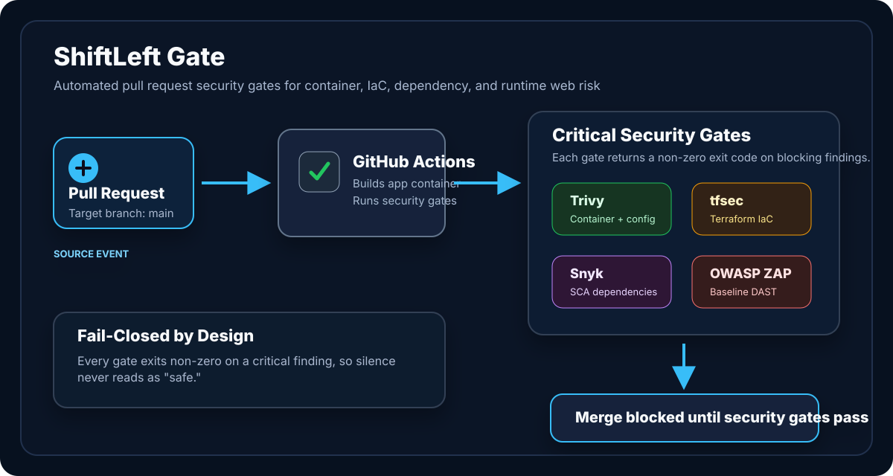
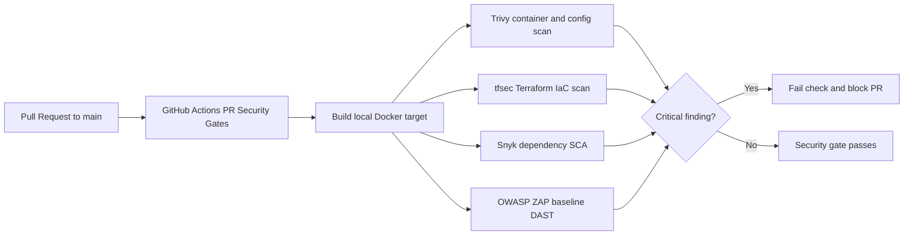

<p align="center">
  
</p>

<h1 align="center">ShiftLeft Gate</h1>

<p align="center">
  A GitHub Actions pipeline that turns <strong>Trivy</strong>, <strong>tfsec</strong>, <strong>Snyk</strong>, and <strong>OWASP ZAP</strong><br />
  into automated pull-request gates that block critical security findings before they reach <code>main</code>.
</p>

<p align="center">
  <a href=".github/workflows/shiftleft-gate.yml"></a>
  <a href="Dockerfile"></a>
  <a href="terraform/main.tf"></a>
  <a href="package.json"></a>
  <a href="zap/rules.tsv"></a>
  <a href="LICENSE"></a>
</p>

<p align="center">
  
  &nbsp;
  
  &nbsp;
  
  &nbsp;
  
  &nbsp;
  
</p>

---

## What this is

A GitHub Actions security pipeline that shifts vulnerability detection into the pull request, before code merges. It integrates **Trivy**, **tfsec**, **Snyk**, and **OWASP ZAP** to enforce automated PR-blocking on critical findings across four layers: container, infrastructure-as-code, dependency, and runtime web risk.

Every gate is **fail-closed**: each scanner is configured to return a non-zero exit code on a critical finding, GitHub Actions marks the check as failed, and branch protection can require that check before merge. The repository ships with intentionally vulnerable fixtures — an outdated Docker base image, an open-to-the-internet security group, pinned CVE-laden npm packages — specifically so you can watch the pipeline catch and block them.

<p align="center">
  
</p>

## Architecture



## Security Gates

| Security Layer | Tool | Coverage | Blocking Behavior |
| --- | --- | --- | --- |
| Container Security | Trivy | OS vulnerabilities, application packages, Dockerfile and configuration misconfigurations | Returns exit code `1` on `CRITICAL` findings |
| Infrastructure as Code | tfsec | Terraform cloud misconfigurations | Blocks on critical IaC findings |
| Software Composition Analysis | Snyk | Vulnerable open-source npm dependencies | Blocks on critical dependency risk |
| Dynamic Application Security Testing | OWASP ZAP | Runtime HTTP security defects against a live container | Blocks when configured ZAP rules fail |

For the detailed governance mapping, see [docs/security-control-matrix.md](docs/security-control-matrix.md).

## PR-Blocking Mechanism

The workflow runs on every pull request targeting `main`. Each scanner is configured to fail closed by returning a non-zero exit code when a critical policy violation is detected. GitHub Actions marks the check as failed, and branch protection can require this check before merge.

This is the core DevSecOps control: security findings are not left as passive reports. They become enforceable quality gates.

Blocking controls are implemented through:

- `Trivy`: `severity: CRITICAL` and `exit-code: "1"`.
- `tfsec`: `--minimum-severity CRITICAL`.
- `Snyk`: `--severity-threshold=critical` with `--fail-on=all`.
- `OWASP ZAP`: `zap-baseline.py` with a committed `zap/rules.tsv` fail policy.
- Shell safety: `set -euo pipefail` in CI script blocks so command failures stop the job immediately.
- Change classification: documentation and governance-only pull requests still satisfy the required check, while application, container, dependency, Terraform, and ZAP policy changes run the full scanner suite.

## Repository Layout

```text
.
├── .github/
│   ├── CODEOWNERS
│   ├── dependabot.yml
│   ├── pull_request_template.md
│   └── workflows/
│       └── shiftleft-gate.yml
├── app/
│   └── server.js
├── assets/
│   └── logo.svg
├── docs/
│   ├── assets/
│   │   └── shiftleft-gate-pipeline.svg
│   ├── branch-protection.md
│   ├── quickstart.md
│   ├── remediation-playbook.md
│   └── security-control-matrix.md
├── terraform/
│   └── main.tf
├── zap/
│   └── rules.tsv
├── Dockerfile
├── Makefile
├── package-lock.json
├── package.json
├── README.md
└── SECURITY.md
```

## Supporting Documentation

- [Quickstart](docs/quickstart.md): local smoke tests and expected scanner behavior.
- [Branch Protection Model](docs/branch-protection.md): recommended merge governance settings.
- [Remediation Playbook](docs/remediation-playbook.md): response guidance for blocked pull requests.
- [Security Control Matrix](docs/security-control-matrix.md): control-to-evidence mapping for reviews and audits.
- [Security Policy](SECURITY.md): disclosure guidance and intentional fixture notes.

## Intentional Vulnerabilities

This repository includes controlled vulnerable examples so the pipeline can prove that it blocks unsafe changes:

- `terraform/main.tf` exposes SSH on `0.0.0.0/0`, which demonstrates IaC misconfiguration detection.
- `Dockerfile` uses the outdated `node:12-buster` base image, which demonstrates container vulnerability detection.
- `package.json` pins vulnerable dependency versions, including a critical `minimist` advisory path for SCA validation.
- `app/server.js` provides a minimal HTTP target so OWASP ZAP can scan a live container during CI.

These examples are intentionally unsafe and are included only to demonstrate security gate enforcement. Run `make audit-critical` locally to see the exact npm advisories the SCA gate would block on.

## GitHub Secret Required

Snyk requires a repository secret named `SNYK_TOKEN`.

```text
SNYK_TOKEN=<your-snyk-api-token>
```

Add it in GitHub under:

```text
Repository Settings > Secrets and variables > Actions > New repository secret
```

The token is consumed only from GitHub Actions secrets and is never committed to source control.

## Why Shift Left

Security reviews that happen late — after code is merged, deployed, or handed to another team — make every fix more expensive and every root cause harder to trace. Moving detection to the pull request changes that:

- Critical vulnerabilities are caught before merge, not after deployment.
- Remediation is cheaper because the developer still has full context on the change.
- Automated policy enforcement prevents the same class of defect from recurring.
- Every protected change produces GitHub Actions logs and ZAP report artifacts as evidence a control actually ran.
- Container, IaC, dependency, and runtime coverage are standardized under one required check instead of four separate manual reviews.

## Branch Protection Recommendation

To make PR-blocking enforceable, configure the GitHub repository with branch protection for `main` and require the `PR Security Gates` workflow check to pass before merging.

Recommended settings:

- Require a pull request before merging.
- Require status checks to pass before merging.
- Require branches to be up to date before merging.
- Require the `PR Security Gates` check.
- Restrict direct pushes to `main`.

## What This Demonstrates

- CI/CD security architecture and shift-left automation design.
- Container vulnerability scanning with Trivy.
- Terraform IaC misconfiguration detection with tfsec.
- Software Composition Analysis governance with Snyk.
- Baseline DAST against an ephemeral CI environment with OWASP ZAP.
- Automated PR-blocking using deterministic scanner exit codes.
- Security control design that maps directly onto the developer's normal pull-request workflow.

## Local Verification

```bash
make verify        # validates workflow YAML, lints app/server.js, and runs the SCA audit
make docker-build   # builds the demo container locally
```

See [docs/quickstart.md](docs/quickstart.md) for the full local smoke-test walkthrough, including how to reproduce the ZAP scan against a locally running container.

## Disclaimer

The vulnerable files in this repository are deliberate test fixtures. They are designed to trigger security tools and should not be deployed to a real production environment.

## License

[MIT](LICENSE)
